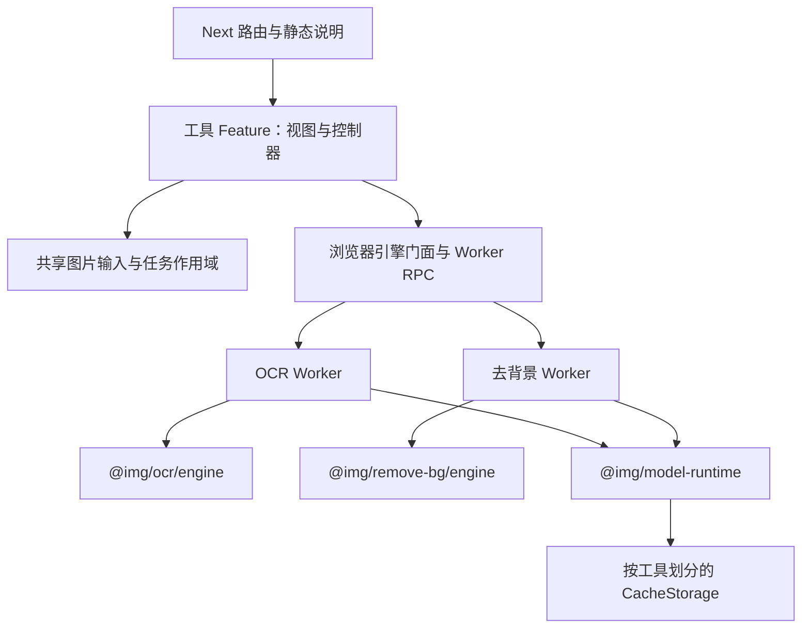

# 图片工具箱架构

## 目标与组织方式

继续维护一个 pnpm/Turborepo monorepo。当前 OCR、去背景共享站点、图片输入与模型交付流程，变更经常需要一起验证；把代码放进多个仓库不会自然消除这些依赖，反而会增加版本、发布和联调成本。先在仓库内建立可验证的包边界。只有当某个引擎已有独立使用者、稳定 API 和独立发布节奏时，再评估发布 npm 包或拆仓。

这次实现保留现有模型、预处理与后处理算法、站点视觉和路由。图片压缩仍是开发中占位，去背景仍标记测试版。首页跳到注册表顺序中第一个启用的工具；默认和 OCR-only 部署仍跳到 `/ocr`，并按照 OCR 页原有行为准备推荐模型。本轮没有新增工具首页，也没有把“首页零模型下载”作为已实现行为。禁用的 OCR 路由仅显示占位页，保持 noindex，不挂载客户端或输出工具 JSON-LD。

## 四个边界



| 边界 | 代码位置 | 负责的事情 |
| --- | --- | --- |
| 站点 | `apps/web/app`、`lib/site`、页面 Shell | 路由、SEO、工具可见性、静态介绍、加载工具界面 |
| 功能模块 | `apps/web/features/ocr`、`features/remove-bg` | React 交互、工具状态、模型选择与业务结果展示 |
| 浏览器宿主 | `shared/browser-image`、`shared/task-scope.ts`、`lib/tool-engines.ts`、`lib/worker-*`、`workers` | 图片解码、任务过期、Worker 运输、部署 URL、跨工具资源交接 |
| 领域包 | `packages/ocr`、`packages/remove-bg` | 本工具的目录 schema、模型生命周期、pipeline 与数据类型 |
| 通用资产库 | `packages/model-runtime` | 结构校验辅助、字节下载、进度、取消、命名空间内缓存与清理 |

通用资产库不再识别 OCR 或 BEN2 的 pipeline。`@img/ocr/models` 与 `@img/remove-bg/models` 分别维护自己的模型 schema；工具算法增加新参数不需要修改通用库。宿主显式注入资产基地址、WASM 路径和缓存命名空间，包中不读取 `NEXT_PUBLIC_*` 环境变量。

### 包的入口

- `@img/ocr` / `@img/remove-bg`：类型、错误和轻量 runtime API。
- `@img/ocr/models` / `@img/remove-bg/models`：模型目录的类型、解析和加载。
- `@img/ocr/engine` / `@img/remove-bg/engine`：包含 ONNX Runtime 的计算入口，仅由对应 Worker 使用。

这些包仍是 `private` 的 workspace 包，exports 直接指向 TypeScript 源文件，由 Next 编译。此时并没有宣称它们是可直接发布的 npm 产品。未来发布需要增加声明文件和独立构建、浏览器兼容性验证、版本与许可证清单。

## 计算与生命周期

工具 Shell 仅在工具启用时挂载本工具 Feature。Feature 通过 `tool-engines.ts` 调用浏览器门面，主线程没有直接导入 ONNX 推理实现。实际执行时才启动对应 Worker，Worker 引入本工具的 `/engine`、构建 runtime 并加载所选模型。OCR 图像裁切使用 `OffscreenCanvas`，Worker 初始化会先检查 Canvas 能力，不支持时明确提示更新浏览器。此时不提供主线程推理回退。

OCR 使用 ORT `/all` 入口，使 WebGPU → WebGL → WASM 的候选后端与真实打包内容一致；去背景保留 WebGPU 优先、不可用时由用户明确选择 WASM 的产品策略。两者都设置单线程 WASM，不要求静态宿主提供 COOP/COEP。真实设备上的 GPU 能力与模型兼容性仍需实际验证。

Worker RPC 有请求 ID、进度事件和错误恢复。输入像素会先复制一份供任务拥有，然后转移其 `ArrayBuffer`；界面留存的原图不会被 detach。这样避免一次隐式结构化复制，同时维持预览与导出功能。并不是零拷贝整个图像处理链。

跨工具切换使用统一的 Worker 资源交接：新工具等待旧工具清理，当前标签页最多保留一个活动计算 Worker。关闭时先让 runtime 取消下载、释放 session；不能及时结束的推理会在清理时限后终止 Worker。运行中的底层 ONNX 调用本身不具备任意指令处的协作式取消，不能把取消 UI 等同于 session.run 立即停止。

OCR 的模型切换与大模型独占规则仍由 `OcrRuntime` 管理。去背景默认在图片提交后加载。TaskScope 负责令过期的图片解码、加载和计算结果失效，防止快速替换图片或离开页面后旧任务覆盖新状态。图片解码和预览仍发生在浏览器主线程；Worker 隔离计算并不意味着整个页面完全没有主线程工作。

缓存分别使用 `image-tools-ocr-v1` 和 `image-tools-remove-bg-v1`。新缓存未命中时，会按逻辑根路径查找旧共享缓存 `ocr-models-v1` 中的资产，不受旧 revision 或部署子路径影响；仅大小和当前目录的 SHA-256 都匹配时复用。写入新缓存成功后才删除对应旧条目，写入失败仍使用已校验字节并保留旧条目。未使用模型、其他工具和内容不同的旧修订均不清理。一次工具目录更新只会清理自己的新命名空间；单工具部署不会因为自己的目录不含另一工具而删除对方缓存。CacheStorage 是浏览器可回收的持久缓存，不保证永久保存；推理 session 和张量是 Worker 内存资源，两者生命周期不同。

## 模型目录与构建产物

源目录与站点输出明确分开：

| 来源 | 生成的运行时目录 |
| --- | --- |
| `packages/ocr/models.json` | `apps/web/public/catalogs/ocr.json` |
| `packages/remove-bg/models.json` | `apps/web/public/catalogs/remove-bg.json` |

每个源目录维持 `{ "models": [...] }` 结构。模型自己的参数由领域 schema 校验；`files` 描述实际分发文件、大小和 SHA-256；`source` 标记上游仓库、不可变 revision、源文件及摘要；`distribution` 声明需要一起分发的许可和来源说明。OCR 的 `configurations` 记录生成字典/对照验证所用的固定版本 YAML。

运行时只请求当前工具的目录，不再读取全局 `/models.json`。普通列表与静态文案不导入计算引擎。OCR 的服务端静态说明读取同一份生成目录，因此 Tiny 镜像不会展示尚未提供的 Small/Medium 模型卡片。

`pnpm dev` 与 `pnpm build` 都先显式生成目录并从已安装 ORT SDK 复制 WASM/loader。目录生成不会下载权重。生成文件不进 Git，源目录和脚本进 Git。

### 部署选择器

| 环境变量 | 语义 |
| --- | --- |
| 未设置 `NEXT_PUBLIC_TOOLS` | 启用注册表中的所有工具，包含尚处于占位/测试状态的既有路由 |
| `NEXT_PUBLIC_TOOLS=ocr` | 仅启用 OCR；生成 OCR 目录 |
| 未设置 `MODEL_IDS` | 每个启用的模型工具保留其全部模型 |
| `MODEL_IDS=ppocrv6-tiny` | 在启用工具内只保留这些逗号分隔的模型 ID |
| `BASE_PATH=/image-tools` | Next 路由、脚本与模型请求使用相同部署前缀 |

显式传入空字符串、重复 ID、未知工具/模型、给已禁用工具选择模型，或者让启用的模型工具没有任何模型，都会失败。若选择集合没有原来推荐的模型，就将集合中的第一个模型设为默认，保证目录仍恰有一个推荐模型。

选择器不会修改包内源目录，也不会删除 `public/models` 中开发者已经下载的权重。Next 完成静态导出后，脚本只从**生成的 `apps/web/out/models`** 移除未被选择的资产，并保留所选模型的 LICENSE 和 MODEL_SOURCE。这样在本地同时准备过 Tiny、Medium、BEN2 后构建 Pages，也不会把 219 MB BEN2 复制到最终发布包。

工具禁用是现有注册表/界面和目录层的部署开关；这不等于所有未启用的静态路由文件与 JavaScript chunk 都已从 Next 输出中删除。增加彻底裁剪路由的构建机制不是本次重构范围。

Turbo 把部署变量、目录来源和生成脚本纳入任务输入。实际模型文件也是 Web build 的输入，避免下载权重后误命中之前“不含模型”的构建缓存。

## 版本固定、许可与发布验证

`onnxruntime-web` 使用固定的 `1.27.0`。复制脚本读取真实安装版本，检查两个引擎所解析的 SDK 版本一致，把 loader/WASM 的版本、文件大小和摘要写入 `public/ort/version.json`。发布检查再对导出文件验证，避免只升级 JavaScript 或复用旧 WASM 导致不兼容。

OCR 六个上游仓库均已记录不可变 revision。权重 SHA-256 来自对应版本的 Hugging Face LFS 元数据；Tiny 下载的实际文件与元数据一致。字典摘要由该固定版本 `inference.yml` 的 `PostProcess.character_dict` 按已有紧凑 UTF-8 JSON 规则计算。Small/Medium 的大权重不需要为了生成目录而下载；真正下载或发布时才用这些上游摘要验证实际文件，不能将“知道摘要”描述为已完成所有模型的本地推理验收。

BEN2 保留原有不可变 revision `c552aa82688edce09f0ac9d2e31ad53d9d629010` 与文件摘要。下载脚本同时修复了嵌套 Bash 函数共享临时变量导致的安装路径覆盖；校验失败的下载不会覆盖正式文件。

模型许可与代码 MIT 许可不同。OCR 需要附带 Apache-2.0 文本；BEN2 Base 需要附带 Prama LLC MIT notice 和 ONNX 转换来源。两者的 LICENSE 与 MODEL_SOURCE 都纳入允许发布的文件集合，缺失会失败。Refiner/full、RMBG 模型和量化实验的许可/资格结论没有因此扩大，继续遵守 README 的边界。

浏览器常规缓存读取与下载验证实际大小；旧共享缓存提升到新命名空间时额外核对 SHA-256，避免把不同内容的旧修订误当成当前模型。没有摘要、无法计算摘要或旧字节不符时走常规下载。完整分发资产的严格摘要校验仍发生在下载准备与发布流程。若未来从第三方 CDN 分发，需要同时设计 CORS、不可变 URL、缓存策略和浏览器侧完整性验证，不能只替换地址。

## 验证与部署

普通代码验证不需要模型权重：

```bash
pnpm install --frozen-lockfile
pnpm test
pnpm typecheck
pnpm lint
pnpm build
```

准备和发布 Tiny 镜像：

```bash
HF_MIRROR=https://huggingface.co bash scripts/download_models.sh --model ppocrv6-tiny
python3 -m pip install pyyaml
python3 scripts/extract_charset.py --model ppocrv6-tiny
BASE_PATH=/image-tools NEXT_PUBLIC_TOOLS=ocr MODEL_IDS=ppocrv6-tiny pnpm build
NEXT_PUBLIC_TOOLS=ocr MODEL_IDS=ppocrv6-tiny pnpm check:assets
```

`pnpm check:assets` 是发布门禁，不是可以跳过的物理资产测试。它检查导出目录与所选源目录一致、全部权重/字典存在、大小及已声明哈希正确、许可/来源存在且适配、没有未选择的权重，并验证 ORT loader/WASM 一致。缺文件会直接退出失败。只执行 `pnpm build` 仍允许没有权重的开发/PR 构建；这类产物不能因编译成功就当成可用的模型发布。

PR CI 执行测试、类型检查、lint、常规静态构建、带 `/image-tools` 前缀的 Tiny 选择构建，以及关闭 OCR 的去背景单工具和压缩占位构建；不为这些检查下载全部权重。每种构建都检查首页入口；关闭 OCR 时还检查其直达路由仅显示 noindex 占位、没有 OCR 目录请求或 Worker。Pages 工作流只下载 Tiny，使用相同选择器生成目录、筛选最终产物并执行严格发布检查。

PR CI 另外下载约 6 MB 的 Tiny 权重并安装固定版本 Playwright，对全工具和 Pages 构建运行真实浏览器 smoke。Pages 发布前也执行代码检查、严格资产检查与浏览器 smoke。浏览器测试在无 COOP/COEP、禁用 GPU 的条件下运行真实 WASM 推理，验证空闲去背景页不加载模型、OCR 只加载 Tiny、TXT 导出、推理中换图不会回写旧结果，以及导航时 Worker 退出。独立浏览器上下文还会预置旧根路径缓存，验证升级后无模型请求即可真实识别、正确写入新 revision，并保留另一工具的旧条目。

本地运行同一检查：

```bash
pnpm exec playwright install chromium
# 先准备 Tiny 并完成构建；此命令自己启动静态测试服务器。
pnpm test:browser
# 若构建时使用子路径，测试使用相同前缀。
BASE_PATH=/image-tools pnpm test:browser
```

可通过 `SMOKE_EXECUTABLE_PATH` 指定已有 Chromium。准备 BEN2 并构建全工具版本后，`SMOKE_REMOVE_BG=1 pnpm test:browser` 还会执行大模型 WASM 推理、检查输出 alpha/PNG 尺寸与透明度、观测主线程 heartbeat，并验证返回 OCR 时去背景 Worker 被释放。该检查验证执行与导出链路，不代替抠图质量评估或 WebGPU 设备测试；常规 CI 不下载 BEN2。

Node 测试覆盖资产与 runtime 契约、失败/过期/清理场景、图片输入和 Worker RPC，不替代真实浏览器推理。浏览器验收应至少覆盖：OCR 真实图片识别、去背景真实透明 PNG、离开工具后资源释放、关闭/重入后的恢复、无 WebGPU 时后端行为，以及带 base path 的模型与 WASM URL。浏览器和 GPU 差异仍需保留设备矩阵验证。

## 新增一个工具

1. 在 `packages/<tool>` 建立领域包。先定义输入/输出、错误、模型 schema 和纯处理函数；需要重引擎时单独提供 `/engine`，避免从根入口导出静态依赖重库的实现。
2. 若需要模型，在该包添加 `models.json`，记录来源、固定版本、大小/可验证摘要、处理参数与分发许可；将目录来源接入 `scripts/model-catalogs.mjs`。不需要模型的工具不应强行套一层模型 runtime。
3. 在 `apps/web/workers` 增加该工具的执行入口，在 `lib/tool-engines.ts` 增加门面，使用独立缓存命名空间并注入部署 URL。复用现有 RPC/清理交接，不复制全局 Worker 管理状态。
4. 在 `features/<tool>` 放视图和控制器。复用图片输入、任务作用域和结果失效机制；业务参数、结果布局和导出方式留在本工具。
5. 添加薄路由/Shell 和 `lib/site/tools.ts` 注册项。验证开启、关闭以及只选择某模型的构建；上线状态和 SEO 内容按产品实际成熟度设置。
6. 增加对真正风险有价值的测试：领域契约、生命周期与至少一条真实浏览器执行路径。检查切换工具没有请求另一工具的模型，也没有留下旧任务写回。

暂不引入运行时插件发现、微前端、独立服务或远程配置平台。当前的静态注册、包入口与按需 Worker 已能承载逐步增加的图片工具；出现明确的独立发布或多人团队需求后，再增加相应机制。
